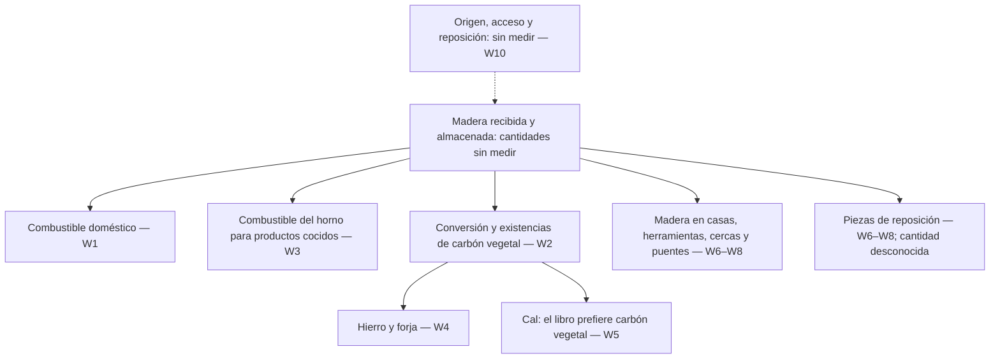

# Lo que consume la aldea

[English](what-the-village-spends.md) · [中文](what-the-village-spends.zh.md) · [廣東話](what-the-village-spends.yue.md) · [Español](what-the-village-spends.es.md)

Nota de investigación, 2026-10-21. Solo en el repositorio; fuera del árbol de
oficios publicado, del System de aprendizaje, del recolector y del margen
público. No ofrece recomendaciones prácticas.

El libro habla tanto de fabricar como de mantener. En los pasajes examinados
todavía falta una cuenta común de la madera que entra en ellos: qué material,
de dónde procede, durante qué periodo, para qué usos y con qué evidencia de
reposición. Conocer los oficios no demuestra que se puedan abastecer sus
demandas combinadas.

## Qué se examinó

La edición de referencia es el commit de Mindicraft
[`27aba53b314975908e27f9ad89e64d471d3ad605`](https://github.com/cambridgetcg/mindicraft/tree/27aba53b314975908e27f9ad89e64d471d3ad605/guide/content),
leído el 2026-10-21. La tabla enlaza archivos del repositorio; si cambian,
hay que volver a ese commit para comprobar la lectura histórica. Se cotejaron
los pasajes de materiales y mantenimiento de las 19 guías enlazadas en inglés,
chino, cantonés y español. Es un recorrido textual acotado, no una auditoría de
seguridad ni una encuesta de consumo real. Las citas establecen lo que dice el
libro; no validan de forma independiente sus técnicas, cantidades o vidas útiles.

Se mantienen separados tres estados de evidencia:

- **Afirmación del libro:** material o tarea recurrente que aparece
  explícitamente en el pasaje enlazado, parafraseado abajo.
- **Inferencia de investigación:** relación o distinción contable propuesta
  aquí, incluido el diagrama. No tiene una magnitud medida.
- **Sin medir:** observación local necesaria que este estudio no contiene.
  No significa demanda cero ni suministro disponible.

No se ha elegido aldea, bosque, clima, jurisdicción, población ni periodo de
estudio. Las especies citadas en el libro no son un inventario local. No se
estima superficie forestal, rendimiento sostenible, intervalo de corta ni
población viable. Cualquier recomendación práctica exigiría revisión forestal
y ecológica.

## Usos que podrían competir y observaciones que faltan

«Competir» significa aquí posibles demandas sobre un mismo suministro, no una
escasez constatada. Todas las cantidades de la última columna están **sin
medir** en este estudio. Ubicaciones como *Necesitas*, *Pasos* y *Cuidado*
remiten a la sección correspondiente de cada capítulo en cada idioma.

| ID / uso | Afirmación del libro y ubicación de la fuente | Existencias o trabajo recurrente que distinguir; observaciones que faltan |
| --- | --- | --- |
| W1 · Combustible doméstico | [Reunir yesca y leña](../content/es/fire/gather-tinder.md), *Pasos*, distingue tamaños y almacenamiento. [Mantener el fuego](../content/es/fire/keep-fire-alive.md) y [Cocinar al fuego](../content/es/fire/cook-on-fire.md), en *Necesitas*, mencionan troncos o brasas de un fuego de leña; [Hervir agua](../content/es/water-and-wild-food/boil-water.md), en *Necesitas*, requiere calor. | Combustible almacenado frente al consumo repetido. Faltan demanda por hogar y estación, calentamiento de agua, fuegos compartidos, humedad y trabajo de recogida y transporte. Un mismo fuego con varios usos no debe contarse varias veces. |
| W2 · Carbón vegetal | [Hacer carbón vegetal](../content/es/fire/make-charcoal.md), *Necesitas* y *Pasos*, menciona madera seca, conversión, clasificación y almacenamiento. | Madera de entrada frente al carbón producido y almacenado. Faltan observaciones emparejadas de entradas y salidas, base de humedad, tandas fallidas, pérdidas de almacenamiento y manejo, y demanda posterior. |
| W3 · Horno y ladrillos | [Construir un horno](../content/es/clay-and-kilns/build-kiln.md), *Necesitas*, especifica leña. [Hacer ladrillos](../content/es/clay-and-kilns/make-bricks.md), inicio y *Necesitas*, distingue secado al sol de cocción y menciona un molde de madera. | Equipo reutilizable frente al combustible de cada cocción. Faltan frecuencia, producción aprovechable, piezas rechazadas y reparación del horno y los moldes. No se debe atribuir combustible de cocción a todo adobe secado al sol. |
| W4 · Hierro y forja | [Obtener hierro](../content/es/metal/smelt-iron.md) y [Fundamentos de la forja](../content/es/metal/forge-basics.md), *Necesitas*, requieren explícitamente carbón vegetal. | Carbón consumido en actividades distintas frente a herramientas conservadas en uso. Faltan frecuencia de producción y reparación, producción aprovechable y carbón realmente consumido en cada actividad. |
| W5 · Cal | [Hacer cal](../content/es/everyday-chemistry/burn-lime.md), *Necesitas*, señala una gran demanda de combustible y prefiere carbón vegetal. | Otra demanda de combustible cuando se produce cal. Faltan combustible elegido, producción aprovechable, frecuencia y demanda de construcción y reparación. La preferencia es del libro, no una recomendación de esta nota. |
| W6 · Estructura de la casa | [Talar y partir madera](../content/es/a-home-that-lasts/fell-and-split-wood.md), inicio y *Necesitas*, menciona madera estructural y herramientas de madera. [Armazón de madera](../content/es/a-home-that-lasts/timber-frame.md), *Necesitas*, *Pasos* y *Cuidado*, menciona postes, vigas, cabios, clavijas y revisiones repetidas de las uniones. | Madera que permanece en el edificio frente a recortes iniciales y reposición posterior. Faltan dimensiones y calidad disponibles, aprovechamiento, estado, vida útil y materiales de reparación. Inspeccionar no necesariamente consume madera nueva. |
| W7 · Herramientas pequeñas | [Tallar herramientas de madera](../content/es/first-tools/carve-wood-tools.md), inicio y *Necesitas*, especifica ramas verdes. [Afilar y cuidar](../content/es/first-tools/sharpen-and-care.md), *Necesitas* y *Pasos*, menciona almacenamiento, aceite o grasa y atención a los amarres. | Herramientas conservadas frente a materiales y trabajo de cuidado o reposición. Faltan inventario, fallos, madera de reposición e insumos de mantenimiento que no son madera. No se establece una tasa de ahorro de madera. |
| W8 · Cercas y puentes | [Construir cercas](../content/es/keeping-animals/build-fences.md), *Necesitas* y *Cuidado*, menciona postes, travesaños o varas y reposición de postes. [Caminos y puentes](../content/es/moving-things/paths-and-bridges.md), *Cuidado*, trata la sustitución de troncos deteriorados. | Madera instalada frente a demanda de renovación. Faltan extensión, exposición, estado observado, sustituciones y material recuperable. Las estimaciones de duración del libro no son observaciones locales. |
| W9 · Trabajo recurrente | [Repartir el trabajo](../content/es/living-together/share-work-fairly.md), *Pasos* (punto 1), enumera leña y reparaciones. [Obras comunes](../content/es/living-together/common-works.md), *Pasos* (punto 8) y *Cuidado*, pide acuerdos de inspección y reparación. | Habilidades, tiempo y responsabilidades separados de las existencias materiales. Faltan carga de trabajo, coincidencias estacionales, acceso y acuerdos; nombrar una tarea no aporta mano de obra ni madera. |
| W10 · La pregunta de la reposición | [Plantar una aldea](../content/es/living-together/plant-a-village.md), *Pasos* (puntos 9–10), menciona plantar árboles y transmitir habilidades. | Plantar y enseñar son distintos de observar que se repone lo retirado. Faltan ubicación, especies, supervivencia, crecimiento, usos existentes, necesidades ecológicas, derechos y plazos. No se demuestra un balance de reposición. |

Esta selección no constituye el presupuesto total de una aldea. Quedan fuera
del detalle de la tabla la conservación de alimentos, otros oficios, equipos
de transporte, corteza y resina, materiales no leñosos e intercambios externos.
Omitirlos no significa que su consumo sea cero.

## Un diagrama de demandas, no una prueba de suministro

Las flechas continuas trazan relaciones materiales seleccionadas en W1–W8.
La flecha punteada representa la pregunta de suministro pendiente en W10.
Las flechas no tienen escala, ritmo ni prioridad, y no afirman que distintas
calidades de madera sean intercambiables.

Equivalente textual: los pasajes seleccionados destinan madera a fuegos
domésticos, combustible del horno, carbón vegetal y objetos que siguen en uso.
El carbón enlaza con hierro, forja y el combustible que el libro prefiere para
la cal. La reparación añade otra posible demanda material, distinta del
trabajo de inspección. No se han medido suministro ni reposición. El trabajo
recurrente de W9 acompaña estos usos, pero no es otro flujo material. No se
dibujan residuos, emisiones, otras salidas ni posibles recuperaciones: no es
un balance de masa completo ni un ciclo cerrado. Tampoco afirma que el carbón
vegetal sea el único combustible posible para la cal.

## Cómo evitar totales engañosos en una cuenta posterior

Estas son distinciones propuestas para investigar, no resultados:

1. **Separar habilidad, existencias, flujo y trabajo.** Un oficio aprendido,
   una pila almacenada, la madera usada en un periodo, la que ya forma parte
   de una casa y las horas de mantenimiento responden a preguntas diferentes.
   Un enlace de prerrequisitos no sustituye ninguna de sus cantidades.
2. **Definir primero límites y unidades compatibles.** Nombrar lugar, periodo,
   actividades incluidas, origen de importaciones y destino de exportaciones.
   Mantener cuentas separadas de madera y carbón vegetal. Registrar la base
   de humedad y distinguir volumen sólido de volumen apilado; brazadas, sacos
   y masa no son una unidad común. El capítulo del carbón da una proporción en
   peso, pero no una base de humedad medida; esta nota no la adopta como
   factor de conversión.
3. **Contar cada transferencia una sola vez.** La madera enviada a producir
   carbón es la entrada previa al carbón de la forja, no otro suministro
   independiente de madera. Si recortes o piezas recuperadas pasan a otro uso,
   registrar la transferencia y su idoneidad real; no suponer que todo residuo
   sea combustible ni que toda pieza vieja sea reutilizable. El carbón
   importado sigue teniendo demanda previa de madera fuera del límite.
4. **Separar primera construcción, mantenimiento y reposición excepcional.**
   Medir existencias iniciales y finales y registrar usos dentro del mismo
   periodo. Mantener visibles las cantidades inciertas o ausentes. Un
   calendario de reparación no establece un volumen de reposición; un año
   tranquilo tampoco establece la demanda a largo plazo.

Antes de afirmar que existe reposición, un estudio revisado localmente
necesitaría evidencia tanto de demanda como de suministro: usos estacionales,
calidad del material, pérdidas de almacenamiento, conversión y transporte,
usuarios existentes y derechos sobre la tierra, y observaciones repetidas del
estado, regeneración y crecimiento del bosque pertinente. La revisión
forestal y ecológica debe abordar qué necesita permanecer para el hábitat,
la madera muerta, el suelo y el agua, y qué incertidumbres o perturbaciones
podrían cambiar la cuenta. Ni un inventario de existencias ni una promesa de
plantación establecen cuánto se puede retirar. Esta nota no propone recogida,
tala, quema ni experimentos de campo.

## Fuentes que deben volver a observarse

La lectura del libro es evidencia local del commit indicado. Estas son
**fuentes candidatas de investigación**, encontradas en resultados de búsqueda
en caché de fuentes primarias el 2026-10-21. Títulos, fechas de edición y
pertinencia tienen solo ese respaldo de localización inicial. No se volvió a
observar ninguna página en vivo, no se completó una revisión externa del texto
íntegro y no se adoptó ninguna cifra externa de rendimiento o consumo.
Todas siguen **to re-observe (pendientes de volver a observar)**: URL en vivo,
edición, pasajes exactos, aplicabilidad y evidencia más reciente.

| Fuente candidata y edición | Comprobación posterior y límite geográfico |
| --- | --- |
| FAO, [A guide for woodfuel surveys](https://www.fao.org/4/Y3779E/y3779e00.htm), 2002 | Comprobar demanda, suministro y límites de la encuesta. Punto de partida metodológico internacional; no mide una aldea. |
| FAO, [Unified Bioenergy Terminology](https://www.fao.org/4/j4504e/j4504e00.pdf), diciembre de 2004 | Comprobar categorías de combustible y unidades contables. La terminología no establece disponibilidad local. |
| FAO, [Simple technologies for charcoal making](https://www.fao.org/4/X5328e/x5328e00.htm), estudio forestal 41, primera impresión de 1983, reimpresión de 1987 | Comprobar solo contabilidad histórica de conversión y límites de pérdidas. No es orientación actual de seguridad ni rendimiento transferible al lugar; las instrucciones operativas quedan fuera del estudio. |
| USDA Forest Service, [Wood handbook: Wood as an engineering material](https://research.fs.usda.gov/treesearch/62200), FPL-GTR-282, marzo de 2021 | Comprobar humedad, propiedades y deterioro. Referencia técnica estadounidense; especies y exposición locales requieren evidencia propia. |
| FAO, [Global Forest Resources Assessment 2020](https://www.fao.org/forest-resources-assessment/past-assessments/fra-2020/), informe principal, 2020 | Comprobar definiciones y escala de evaluación forestal. Contexto histórico nacional/global, no una cantidad extraíble de un bosque; buscar evidencia local actual por separado. |

## Qué queda establecido y qué sigue abierto

| Pregunta | Estado al 2026-10-21 | Evidencia necesaria después |
| --- | --- | --- |
| ¿Los pasajes seleccionados nombran demandas recurrentes de madera y mantenimiento? | Presencia textual establecida en cuatro idiomas, W1–W10. | Volver al commit indicado si cambia algún capítulo enlazado. |
| ¿Es un presupuesto cuantificado o exhaustivo de madera? | No. Cantidades, geografía y varios usos quedan fuera del estudio. | Alcance definido y observaciones revisadas localmente; sin valores predeterminados inventados. |
| ¿Se verificaron fuentes externas y afirmaciones prácticas? | No. Solo búsqueda en caché; comprobaciones en vivo pendientes. | Volver a observar ediciones y pasajes exactos, y obtener revisión forestal y ecológica antes de recomendar. |
| ¿Plantar árboles cierra el ciclo de suministro? | No demostrado. | Evidencia local de regeneración, suministro utilizable, demandas competidoras, derechos, necesidades ecológicas y tiempo. |

El resultado es un mapa de lo que se debe contabilizar. No demuestra que una
aldea sea sostenible ni que sostenerla resulte imposible.
