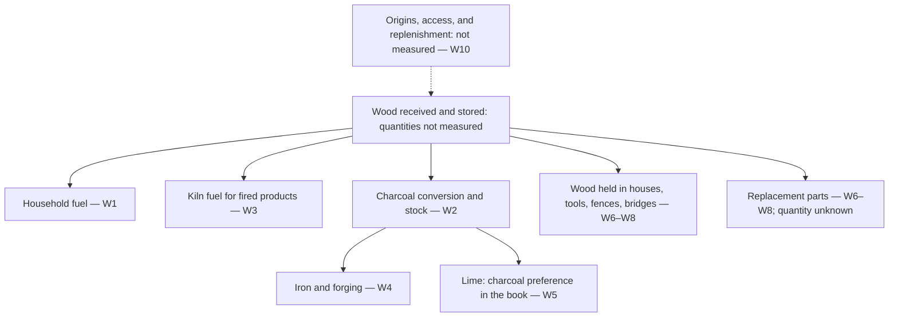

# What the village spends

[English](what-the-village-spends.md) · [中文](what-the-village-spends.zh.md) · [廣東話](what-the-village-spends.yue.md) · [Español](what-the-village-spends.es.md)

Research note, 2026-10-21. Repository-only; outside the published craft tree,
learning System, collector, and public margin. No practical recommendation.

The book names both making and upkeep. What remains missing in the passages
examined here is a common account of the wood entering them: which material,
from where, over what period, serving which uses, and replenished on what
evidence. Knowing the crafts does not establish that their combined demands
can be supplied.

## What was examined

The source edition is Mindicraft commit
[`27aba53b314975908e27f9ad89e64d471d3ad605`](https://github.com/cambridgetcg/mindicraft/tree/27aba53b314975908e27f9ad89e64d471d3ad605/guide/content),
read on 2026-10-21. The table links to repository files; use that commit when
checking the historical reading after those files change. Material and upkeep
passages in the 19 linked guides were checked in English, Chinese, Cantonese,
and Spanish. This is a bounded textual trace, not a safety audit or a survey
of actual consumption. A citation below establishes what the book says; it
does not independently validate its techniques, quantities, or service lives.

Three evidence states stay separate:

- **Book statement:** a material or recurring task explicitly named in a
  linked passage, paraphrased below.
- **Research inference:** a connection or accounting distinction proposed
  here, including the diagram. It has no measured magnitude.
- **Not measured:** a required local observation absent from this study.
  It is neither zero demand nor available supply.

No village, woodland, climate, jurisdiction, population, or study period has
been selected. The book's species examples are not a local inventory. No
forest area, sustainable yield, harvest interval, or viable population is
estimated. Forestry and ecological scrutiny would be needed before any
practical recommendation.

## Competing uses and the observations still missing

“Competing” here means claims on a possible shared supply, not a finding of
actual scarcity. Every quantity in the last column is **not measured** here.
Locations such as *You need* and *Watch out* refer to the linked chapter's
corresponding section in each language.

| ID / use | Book statement and source location | Stock or recurring work to distinguish; missing observations |
| --- | --- | --- |
| W1 · Household fuel | [Gather tinder](../content/en/fire/gather-tinder.md), *Steps*, distinguishes fuel sizes and storage. [Keep fire](../content/en/fire/keep-fire-alive.md) and [Cook on fire](../content/en/fire/cook-on-fire.md), *You need*, name logs or a wood-fed coal bed; [Boil water](../content/en/water-and-wild-food/boil-water.md), *You need*, requires heat. | Stored fuel versus repeated use. Missing: household and seasonal demand, water-heating demand, shared fires, moisture, collection and transport work. The same fire serving several purposes must not be counted several times. |
| W2 · Charcoal | [Make charcoal](../content/en/fire/make-charcoal.md), *You need* and *Steps*, names dry wood, conversion, sorting, and storage. | Wood input versus charcoal output and stock. Missing: paired input/output observations, moisture basis, failed batches, storage and handling losses, and downstream demand. |
| W3 · Kiln and bricks | [Build a kiln](../content/en/clay-and-kilns/build-kiln.md), *You need*, specifies firewood. [Make bricks](../content/en/clay-and-kilns/make-bricks.md), opening and *You need*, distinguishes sun-dried and fired bricks and names a wooden mould. | Reusable equipment versus fuel per firing. Missing: batch frequency, usable output, rejects, kiln and mould repairs. Do not assign firing fuel to every sun-dried brick. |
| W4 · Iron and forging | [Smelt iron](../content/en/metal/smelt-iron.md) and [Forge basics](../content/en/metal/forge-basics.md), *You need*, explicitly require charcoal. | Charcoal consumed in separate activities versus tools kept in use. Missing: production and repair frequency, usable output, and charcoal actually consumed in each activity. |
| W5 · Lime | [Burn lime](../content/en/everyday-chemistry/burn-lime.md), *You need*, names a large fuel requirement and prefers charcoal. | A further fuel demand when lime is made. Missing: fuel actually selected, usable output, firing frequency, and demand from building and repair. The preference is the book's, not a recommendation here. |
| W6 · House structure | [Fell and split wood](../content/en/a-home-that-lasts/fell-and-split-wood.md), opening and *You need*, names structural wood and wooden tools. [Timber frame](../content/en/a-home-that-lasts/timber-frame.md), *You need*, *Steps*, and *Watch out*, names posts, beams, rafters, pegs, and repeated joint checks. | Wood held in a building versus initial offcuts and later replacement. Missing: dimensions and quality available, usable recovery, condition, service life, and repair material. Inspection alone need not consume new wood. |
| W7 · Small tools | [Carve wooden tools](../content/en/first-tools/carve-wood-tools.md), opening and *You need*, specifies green branches. [Sharpen and care](../content/en/first-tools/sharpen-and-care.md), *You need* and *Steps*, names storage, oil or fat, and attention to lashings. | Tools retained versus materials and work for care or replacement. Missing: tool inventory, failures, replacement wood, and non-wood upkeep inputs. No wood-saving rate is established. |
| W8 · Fences and bridges | [Build fences](../content/en/keeping-animals/build-fences.md), *You need* and *Watch out*, names posts, rails or rods, and replacement posts. [Paths and bridges](../content/en/moving-things/paths-and-bridges.md), *Watch out*, discusses replacing deteriorated logs. | Installed wood versus renewal demand. Missing: extent, exposure, observed condition, replacements, and recoverable material. The book's lifespan estimates are not local observations. |
| W9 · Recurring work | [Share work fairly](../content/en/living-together/share-work-fairly.md), step 1, lists firewood and repairs. [Common works](../content/en/living-together/common-works.md), step 8 and *Watch out*, calls for inspection and repair arrangements. | Skills, time, and responsibilities stay separate from material stocks. Missing: workload, seasonal overlaps, access, and agreed arrangements; naming a job supplies neither labour nor wood. |
| W10 · Replenishment question | [Plant a village](../content/en/living-together/plant-a-village.md), steps 9–10, names planting trees and passing on skills. | Planting and teaching are distinct from observed replacement of withdrawals. Missing: location, species, survival, growth, existing uses, ecological requirements, rights, and timing. No replenishment balance is demonstrated. |

This selection is not a total village budget. Food preservation, other crafts,
transport equipment, bark and resin, non-wood materials, and exchanges beyond
the village remain outside the detailed table. Their omission is not zero use.

## A diagram of demands, not a proof of supply

Solid arrows trace selected material relationships in W1–W8. The dotted arrow
is the unanswered supply question in W10. Arrows have no scale, rate, priority,
or claim that different wood qualities are interchangeable.

Text equivalent: the selected passages put wood into household fires, kiln
fuel, charcoal, and objects kept in use. Charcoal connects onward to iron,
forging, and the book's preferred lime fuel. Repair adds another possible
material demand, separate from the work of inspection. Supply and
replenishment have not been measured. W9's recurring work accompanies these
uses but is not another material flow. Residues, emissions, other outputs,
and possible recovery are not drawn: this is not a complete mass balance or
a closed loop. Nor does it say charcoal is the only possible lime fuel.

## How a later account could avoid misleading totals

These are proposed research distinctions, not results:

1. **Separate skill, stock, flow, and work.** A learned craft, a stored pile,
   wood used during a period, timber already in a house, and hours of upkeep
   answer different questions. A prerequisite link cannot stand for any of
   their quantities.
2. **Define a boundary and compatible units first.** Name the place, period,
   included activities, origin of imports, and destination of exports. Keep
   wood and charcoal accounts separate. Record moisture basis and distinguish
   solid volume from stacked volume; an armload, sack, and mass are not a
   shared unit. The charcoal chapter reports a weight ratio but no measured
   moisture basis; this note does not adopt it as a conversion factor.
3. **Count transfers once.** Wood sent to charcoal production is upstream of
   the charcoal used at the forge, not an additional independent wood supply.
   If offcuts or recovered parts later move to another use, record that
   transfer and its actual suitability; do not assume all residues are fuel
   or all old parts reusable. Imported charcoal still has an upstream wood
   demand outside the boundary.
4. **Separate first construction, upkeep, and exceptional replacement.**
   Measure opening and closing stores and record uses within the same period.
   Keep uncertain or missing quantities visible. A repair schedule does not
   establish a replacement volume, and a quiet year does not establish
   long-term demand.

Before any replenishment claim, a locally reviewed study would need evidence
on both demand and supply: seasonal uses; material quality; storage, conversion,
and transport losses; existing users and land rights; and repeated observations
of the relevant woodland's condition, regeneration, and growth. Forestry and
ecological review must address what needs to remain for habitat, deadwood,
soil, and water, and what uncertainty or disturbance could change the account.
Neither a standing inventory nor a planting promise establishes an amount
available for removal. No collection, felling, burning, or field experiment is
proposed by this note.

## Sources to re-observe

The book reading above is local evidence from the stated commit. The following
are **candidate research sources**, found in cached primary-source search
results on 2026-10-21. Titles, edition dates, and relevance have only that
discovery-level support. No live page was re-observed, no full external source
review was completed, and no external yield or consumption figure was adopted.
Every entry remains **to re-observe** for live URL, edition, exact supporting
passages, applicability, and newer evidence.

| Candidate and edition | Later checking purpose and geographic limit |
| --- | --- |
| FAO, [A guide for woodfuel surveys](https://www.fao.org/4/Y3779E/y3779e00.htm), 2002 | Check demand, supply, and survey boundaries. International methodological starting point; no village measurement. |
| FAO, [Unified Bioenergy Terminology](https://www.fao.org/4/j4504e/j4504e00.pdf), December 2004 | Check fuel categories and accounting units. Terminology cannot establish local availability. |
| FAO, [Simple technologies for charcoal making](https://www.fao.org/4/X5328e/x5328e00.htm), Forestry Paper 41, first printing 1983, reprint 1987 | Check historical conversion accounting and loss boundaries only. Not current safety guidance or a locally transferable yield; operational instructions are outside this study. |
| USDA Forest Service, [Wood handbook: Wood as an engineering material](https://research.fs.usda.gov/treesearch/62200), FPL-GTR-282, March 2021 | Check moisture, material properties, and deterioration. US technical reference; local species and exposure need separate evidence. |
| FAO, [Global Forest Resources Assessment 2020](https://www.fao.org/forest-resources-assessment/past-assessments/fra-2020/), main report, 2020 | Check forest assessment definitions and scale. Historical national/global context, not a woodland allowance; identify current local evidence separately. |

## What is established, and what remains open

| Question | Status on 2026-10-21 | Evidence needed next |
| --- | --- | --- |
| Does the selected book material name recurring wood demands and upkeep? | Established as textual presence across four languages, W1–W10. | Recheck against the pinned edition if any linked chapter changes. |
| Is this a quantified or exhaustive wood budget? | No. Quantities, geography, and several uses remain outside the study. | A defined scope and locally reviewed observations; no invented defaults. |
| Have the external sources and practical claims been verified? | No. Cached discovery only; live-source checks pending. | Re-observe exact editions and passages, then obtain forestry and ecological scrutiny before recommendations. |
| Does tree planting close the supply loop? | Not demonstrated. | Local evidence on regeneration, usable supply, competing demands, rights, ecological needs, and time. |

The result is a map of what must be accounted for. It establishes neither a
sustainable village nor a finding that one is impossible.
