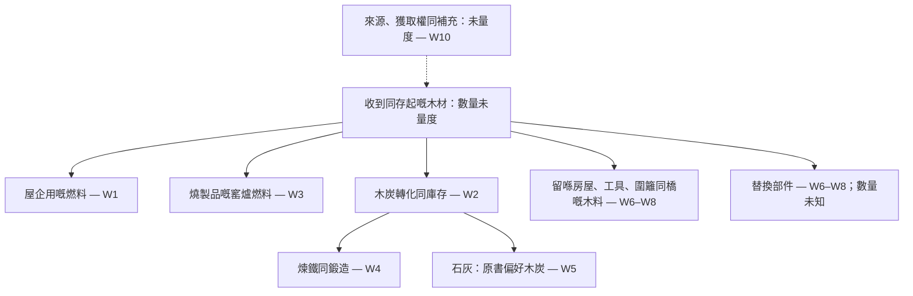

# 條村一直用緊啲乜

[English](what-the-village-spends.md) · [中文](what-the-village-spends.zh.md) · [廣東話](what-the-village-spends.yue.md) · [Español](what-the-village-spends.es.md)

研究札記，2026-10-21。只放喺倉庫；唔入已發布嘅技藝樹、學習 System、收集器或者公共頁邊欄。呢篇唔提供實作建議。

本書有講製作，亦有講保養。今次睇過嘅段落，仲未有一份貫通各章嘅木材帳：邊種材料、由邊度嚟、喺幾長時間內用喺邊啲用途，同埋憑乜證據話補得返。識做呢啲手藝，唔等於已經證明佢哋加埋嘅需求有足夠供應。

## 睇過啲乜

來源版本係 Mindicraft 提交
[`27aba53b314975908e27f9ad89e64d471d3ad605`](https://github.com/cambridgetcg/mindicraft/tree/27aba53b314975908e27f9ad89e64d471d3ad605/guide/content)，
查閱日期係 2026-10-21。表內連結指向倉庫檔案；如果檔案之後改咗，要返去呢個提交核對當時嘅文字。連結到嘅 19 篇指南，涉及材料同保養嘅段落，已經對過英文、中文、廣東話同西班牙文。呢個係有範圍嘅文本追蹤，唔係安全審計，亦唔係實際消耗調查。下面嘅引用只證明本書有咁講，唔會獨立證實入面嘅技術、數量或者使用年期。

三種證據狀態分開保留：

- **書中陳述：** 連結段落明確提過嘅材料或者反覆要做嘅工作，下面用轉述呈現。
- **研究推斷：** 呢篇提出嘅關連或者記帳區分，包括幅圖；全部都冇實測數值。
- **未量度：** 呢個研究欠缺嘅必要本地觀察。唔係零需求，亦唔係可用供應。

仲未揀定村落、林地、氣候、司法管轄區、人口或者研究時段。書入面舉嘅樹種例子唔係本地資源清單。呢篇唔估森林面積、可持續產量、採伐間隔或者養得起幾多人。提出任何實作建議之前，都需要林業同生態審查。

## 各種用途，同埋仲欠啲乜觀察

呢度講用途「競爭」，係話佢哋可能向同一份供應提出需求，唔係已經發現實際短缺。最後一欄要知道嘅數量，喺呢個研究入面全部都係**未量度**。「你要有」「點做」「小心」等位置，係指各語言相應章節嘅對應部分。

| 編號／用途 | 書中陳述同來源位置 | 要分清嘅存量或者經常性工作；欠缺嘅觀察 |
| --- | --- | --- |
| W1 · 屋企用嘅燃料 | [執火絨同柴](../content/yue/fire/gather-tinder.md)嘅「點做」分開燃料粗幼同儲存。[留住爐火](../content/yue/fire/keep-fire-alive.md)同[用火煮食](../content/yue/fire/cook-on-fire.md)嘅「你要有」列出木柴或者燒木形成嘅炭床；[煲滾水](../content/yue/water-and-wild-food/boil-water.md)嘅「你要有」要求熱源。 | 存起嘅燃料同反覆消耗分開記。欠：每家同各季需求、熱水需求、共用火源、含水率、收集同運送工夫。同一堆火做幾樣嘢，唔可以重複計幾次。 |
| W2 · 木炭 | [整木炭](../content/yue/fire/make-charcoal.md)嘅「你要有」同「點做」講到乾木、轉化、分揀同儲存。 | 入去嘅木材，同出嚟嘅木炭及存炭量分開記。欠：配對嘅投入／產出觀察、含水率計量基準、失敗批次、儲存同搬運損耗，以及下游需求。 |
| W3 · 窰同磚 | [起窰](../content/yue/clay-and-kilns/build-kiln.md)嘅「你要有」指定柴火。[整磚](../content/yue/clay-and-kilns/make-bricks.md)開頭同「你要有」分開曬乾泥磚同燒磚，亦列出木製磚模。 | 用得返嘅設備同每次燒製嘅燃料分開記。欠：批次頻率、合用成品、廢品、窰同磚模維修。唔可以將燒窰燃料算落每一塊曬乾泥磚度。 |
| W4 · 鐵同鍛造 | [煉鐵](../content/yue/metal/smelt-iron.md)同[鍛造基礎](../content/yue/metal/forge-basics.md)嘅「你要有」明確需要木炭。 | 各項活動用咗嘅炭，同繼續用緊嘅工具分開記。欠：生產同維修頻率、合用成品，以及各項活動實際用幾多炭。 |
| W5 · 石灰 | [燒石灰](../content/yue/everyday-chemistry/burn-lime.md)嘅「你要有」講明要大量燃料，並且偏向用木炭。 | 整石灰時另一項燃料需求。欠：實際揀咗邊種燃料、合用產出、燒製頻率、建造同維修要幾多。呢個偏好係原書嘅講法，唔係呢篇嘅建議。 |
| W6 · 房屋結構 | [斬木同劈木](../content/yue/a-home-that-lasts/fell-and-split-wood.md)開頭同「你要有」講到結構木料同木製工具。[木屋架](../content/yue/a-home-that-lasts/timber-frame.md)嘅「你要有」、「點做」同「小心」列出柱、樑、椽、木釘，同埋反覆檢查接位。 | 留喺間屋入面嘅木料、最初嘅邊角料、之後嘅替換材料分開記。欠：有得用嘅尺寸同質素、合用材料回收率、狀況、使用年期同維修用料。檢查本身未必要用新木。 |
| W7 · 細工具 | [削木工具](../content/yue/first-tools/carve-wood-tools.md)開頭同「你要有」指定青枝。[磨利同保養](../content/yue/first-tools/sharpen-and-care.md)嘅「你要有」同「點做」講到儲存、油脂同綁口保養。 | 留用嘅工具，同保養或者更換要用嘅材料同工夫分開記。欠：工具清單、損壞、更換木料同非木質保養投入。未有建立任何慳木比率。 |
| W8 · 圍籬同橋 | [起圍籬](../content/yue/keeping-animals/build-fences.md)嘅「你要有」同「小心」講到柱、橫杆或者枝條，同埋換柱。[路同橋](../content/yue/moving-things/paths-and-bridges.md)嘅「小心」討論更換腐壞木段。 | 裝咗嘅木料同更新需求分開記。欠：規模、暴露條件、實際觀察到嘅狀況、更換情況同可回收材料。書入面嘅年期估計唔係本地觀察。 |
| W9 · 經常性工作 | [公平分工](../content/yue/living-together/share-work-fairly.md)嘅「點做」第 1 項列出柴火同維修。[公共工程](../content/yue/living-together/common-works.md)嘅「點做」第 8 項同「小心」要求安排檢查同維修。 | 技能、時間同責任，同材料存量分開。欠：工作量、季節重疊、使用權同大家同意嘅安排；寫低一份工，唔等於有人手，亦唔等於有木。 |
| W10 · 補充供應嘅問題 | [建立村落](../content/yue/living-together/plant-a-village.md)嘅「點做」第 9–10 項講到種樹同傳手藝。 | 種植同教學，同實測證明補得返取用量，係唔同嘅事。欠：地點、樹種、成活、生長、現有用途、生態需求、權利同時間。未有證明收支補得平。 |

呢個選段唔係成條村嘅總預算。保存食物、其他手藝、運輸器具、樹皮同樹脂、非木材料，同埋村外交換，都未入呢張表嘅詳細分析。冇列出唔等於冇消耗。

## 需求圖，唔係供應證明

實線表示 W1–W8 揀出嚟嘅材料關係。虛線表示 W10 仲未答到嘅供應問題。箭嘴冇數量、速率或者優先次序，亦唔代表唔同質素嘅木材換得埋。

文字等價說明：所選段落將木材用喺家庭火源、窰爐燃料、木炭，同埋繼續用緊嘅物件。木炭再通去煉鐵、鍛造，同原書偏好嘅石灰燃料。維修可能再需要材料，同檢查嗰份工夫分開。供應同補充仲未量度。W9 嘅經常性工作伴住呢啲用途，但唔係另一股材料流。剩餘物、排放、其他產出同可能回收嘅部分冇畫出嚟：呢幅唔係完整物料平衡，亦唔係閉合循環。佢亦冇話木炭係燒石灰唯一可以用嘅燃料。

## 之後記帳點樣避免誤導性嘅總數

下面係建議用嘅研究區分，唔係研究結果：

1. **分開技能、存量、流量同工作。** 學識一門手藝、存起一堆木、某段時間用咗嘅木、已經裝喺屋入面嘅木料，同保養工時，答緊唔同問題。先修關係代替唔到其中任何數量。
2. **先定邊界同可比較嘅單位。** 寫清地點、時段、包括嘅活動、輸入物來源同輸出物去向。木同炭分帳。記錄含水率計量基準，分清實材體積同堆積體積；一抱、一袋同質量唔係同一個單位。木炭章有重量比，但冇實測含水率基準；呢篇唔會攞佢做換算系數。
3. **轉移只計一次。** 送去製炭嘅木，係鍛爐用炭嘅上游，唔係另一份獨立木材供應。如果邊角料或者回收部件轉咗用途，要記錄呢次轉移同實際啱唔啱用；唔可以當所有剩餘物都係燃料，亦唔可以當舊部件全部用得返。輸入條村嘅木炭，喺邊界外面仍然有上游木材需求。
4. **分開初建、保養同非常規更換。** 量度期初同期末庫存，喺同一時段記用途。唔肯定或者欠缺嘅數量要保留出嚟。維修日程唔證明要換幾多體積，一個平靜年亦唔證明長期需求。

講得出補充供應嘅主張之前，經本地審查嘅研究要同時有需求同供應證據：季節用途、材料質素、儲存／轉化／運輸損耗、現有使用者同土地權利，以及對相關林地狀況、更新同生長嘅重複觀察。林業同生態審查要處理棲息地、枯死木、泥土同水需要留低啲乜，同埋邊啲不確定性或者擾動會改變條數。現存資源清單同種樹承諾，都唔可以單獨證明有幾多可以攞走。呢篇唔提出採集、斬樹、燃燒或者實地試驗。

## 要重新觀察嘅來源

上面對本書嘅閱讀，係指定提交入面嘅本地文本證據。以下係 2026-10-21 喺第一手來源嘅快取搜尋結果搵到嘅**候選研究來源**。標題、版本日期同相關性，目前只得到發現層面嘅支持。冇重新觀察過任何即時網頁，冇完成外部來源全文審查，亦冇採用外部產量或者消耗數字。每項仍然係 **to re-observe（要重新觀察）**：要查即時網址、版本、準確支持段落、適用範圍同較新證據。

| 候選來源同版本 | 之後核對嘅目的同地理限制 |
| --- | --- |
| FAO，[A guide for woodfuel surveys](https://www.fao.org/4/Y3779E/y3779e00.htm)，2002 | 核對需求、供應同調查邊界。國際方法起點，唔係村落實測。 |
| FAO，[Unified Bioenergy Terminology](https://www.fao.org/4/j4504e/j4504e00.pdf)，2004 年 12 月 | 核對燃料分類同記帳單位。術語證明唔到本地可用量。 |
| FAO，[Simple technologies for charcoal making](https://www.fao.org/4/X5328e/x5328e00.htm)，林業文集第 41 號，1983 年初版、1987 年重印 | 只核對歷史轉化記帳同損耗邊界。唔係現行安全指引，亦唔係可以直接搬過嚟嘅本地產率；操作指令唔喺研究範圍。 |
| USDA Forest Service，[Wood handbook: Wood as an engineering material](https://research.fs.usda.gov/treesearch/62200)，FPL-GTR-282，2021 年 3 月 | 核對含水、材料性能同劣化。美國技術參考；本地樹種同暴露條件要另外有證據。 |
| FAO，[Global Forest Resources Assessment 2020](https://www.fao.org/forest-resources-assessment/past-assessments/fra-2020/)，主報告，2020 | 核對森林評估定義同尺度。歷史國家／全球背景，唔係林地可採量；要另外搵現時本地證據。 |

## 確立咗啲乜，仲有乜未有答案

| 問題 | 2026-10-21 嘅狀態 | 下一步要有嘅證據 |
| --- | --- | --- |
| 所選書中文字，有冇講反覆發生嘅木材需求同保養？ | 已確立四種語言都有相關文字，見 W1–W10。 | 任何連結章節改咗，要返去指定版本再核對。 |
| 呢份係咪量化或者完整無遺嘅木材預算？ | 唔係。數量、地理條件同多種用途仲喺研究之外。 | 清楚界定範圍，再取得經本地審查嘅觀察；唔作預設數值。 |
| 外部來源同實作主張核實咗未？ | 未。只有快取發現；即時來源檢查待辦。 | 重新觀察準確版本同段落，提出建議前要有林業同生態審查。 |
| 種樹有冇閉合供應循環？ | 未證明。 | 本地更新、可用供應、競爭需求、權利、生態需要同時間方面嘅證據。 |

結果係一張要計入帳嘅事項圖。佢冇證明條村可持續，亦冇證明條村唔可能持續。
