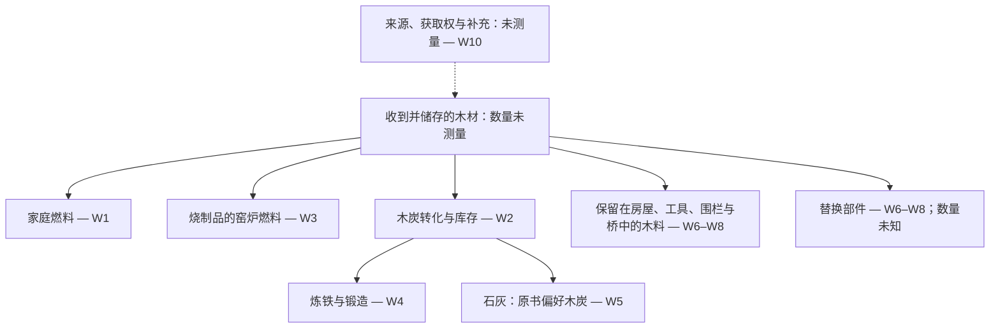

# 村庄不断消耗着什么

[English](what-the-village-spends.md) · [中文](what-the-village-spends.zh.md) · [廣東話](what-the-village-spends.yue.md) · [Español](what-the-village-spends.es.md)

研究札记，2026-10-21。仅存于仓库；不进入已发布的技艺树、学习 System、采集器或公共页边栏。本文不提供实践建议。

书中既讲制作，也讲养护。在本次查阅的段落中，仍然缺少一份贯通各章的木材账：什么材料，从哪里来，在多长时间内，用于哪些用途，又凭什么证据判断补得回来。懂得这些技艺，并不能证明它们合起来的需求有足够供给。

## 查阅了什么

来源版本为 Mindicraft 提交
[`27aba53b314975908e27f9ad89e64d471d3ad605`](https://github.com/cambridgetcg/mindicraft/tree/27aba53b314975908e27f9ad89e64d471d3ad605/guide/content)，
查阅日期为 2026-10-21。表中的链接指向仓库文件；若文件后来改变，应回到此提交核对当时的文字。所链接的 19 篇指南，其材料与养护相关段落均核对了英语、中文、粤语和西班牙语版本。这是范围有限的文本追踪，不是安全审计，也不是实际消耗调查。下文的引用只证明书中有这种说法，不独立证实其中的技术、数量或使用寿命。

三种证据状态分别保留：

- **书中陈述：** 链接段落明确提到的材料或反复要做的工作，以下用转述呈现。
- **研究推断：** 本文提出的联系或记账区分，包括图示；均无实测数值。
- **未测量：** 本研究缺少的必要当地观察。既不是零需求，也不是可用供给。

尚未选定村庄、林地、气候、司法辖区、人口或研究时段。书中的树种举例不是当地资源清单。本文不估算森林面积、可持续产量、采伐间隔或可维持的人口。提出任何实践建议前，都需要林业和生态审查。

## 各种用途与仍然缺失的观察

这里说用途“竞争”，是说它们可能向同一供给提出需求，并非已发现实际短缺。末栏所需的数量在本研究中均为**未测量**。“你需要”“步骤”“注意”等位置，指各语言对应章节的相应部分。

| 编号／用途 | 书中陈述及来源位置 | 要分清的存量或经常性工作；缺失的观察 |
| --- | --- | --- |
| W1 · 家庭燃料 | [收集火绒和柴](../content/zh/fire/gather-tinder.md)的步骤区分燃料粗细及储存。[保留火种](../content/zh/fire/keep-fire-alive.md)和[用火做饭](../content/zh/fire/cook-on-fire.md)的材料清单列出木柴或烧木形成的炭床；[烧开水](../content/zh/water-and-wild-food/boil-water.md)的材料清单要求热源。 | 库存燃料与反复消耗分别记。缺：家庭及季节需求、热水需求、共用火源、含水率、收集和运输工作。同一堆火兼作几种用途，不能重复计入几次。 |
| W2 · 木炭 | [制作木炭](../content/zh/fire/make-charcoal.md)的材料清单与步骤提到干木、转化、分拣和储存。 | 投入的木材与产出的木炭及其库存分别记。缺：配对的投入／产出观察、含水率计量基准、失败批次、储存和搬运损耗，以及后续需求。 |
| W3 · 窑与砖 | [建窑](../content/zh/clay-and-kilns/build-kiln.md)的材料清单指定柴火。[制砖](../content/zh/clay-and-kilns/make-bricks.md)开头与材料清单区分晒干的土坯和烧结砖，并列出木制砖模。 | 可重复使用的设备与每次烧制的燃料分别记。缺：批次频率、合用成品、废品、窑及砖模的修补。不能把烧窑燃料分摊给每一块晒干的土坯。 |
| W4 · 铁与锻造 | [炼铁](../content/zh/metal/smelt-iron.md)和[锻造基础](../content/zh/metal/forge-basics.md)的材料清单明确要求木炭。 | 各项活动消耗的木炭与继续使用的工具分别记。缺：生产和维修频率、合用成品，以及各项活动实际耗炭。 |
| W5 · 石灰 | [烧石灰](../content/zh/everyday-chemistry/burn-lime.md)的材料清单说明需要大量燃料，并偏好木炭。 | 制石灰时的另一项燃料需求。缺：实际选择的燃料、合用产出、烧制频率、建造与维修所需数量。这一偏好来自原书，不是本文的建议。 |
| W6 · 房屋结构 | [伐木与劈木](../content/zh/a-home-that-lasts/fell-and-split-wood.md)开头及材料清单提到结构木料与木制工具。[木屋架](../content/zh/a-home-that-lasts/timber-frame.md)的材料、步骤和注意事项列出柱、梁、椽、木销，以及反复检查接头。 | 房屋中保留的木料、最初的边角料及日后的替换材料分别记。缺：可用尺寸与质量、合用材料回收率、状况、使用寿命和修缮用料。检查本身未必消耗新木材。 |
| W7 · 小工具 | [雕削木工具](../content/zh/first-tools/carve-wood-tools.md)开头及材料清单指定青枝。[磨利与养护](../content/zh/first-tools/sharpen-and-care.md)的材料清单和步骤提到储存、油脂与绑扎养护。 | 留用的工具与保养或更换所需材料和工作分别记。缺：工具清单、损坏、更换木料及非木质养护投入。尚未建立任何节木率。 |
| W8 · 围栏与桥 | [建围栏](../content/zh/keeping-animals/build-fences.md)的材料与注意事项提到桩、横杆或枝条，以及更换桩子。[道路与桥](../content/zh/moving-things/paths-and-bridges.md)的注意事项讨论更换腐坏木段。 | 已安装的木料与更新需求分别记。缺：规模、暴露条件、实测状况、更换情况及可回收材料。书中的寿命估计不是当地观察。 |
| W9 · 经常性工作 | [公平分工](../content/zh/living-together/share-work-fairly.md)步骤 1 列出柴火与修理。[公共工程](../content/zh/living-together/common-works.md)步骤 8 及注意事项要求安排检查和修缮。 | 技能、时间和责任与材料存量分开。缺：工作量、季节性重叠、使用权及商定安排；写出一项工作，既不等于有人力，也不等于有木材。 |
| W10 · 补充供给的问题 | [建立村庄](../content/zh/living-together/plant-a-village.md)步骤 9–10 提到种树和传授技艺。 | 种植和教学，与实测证实补回取用量，是不同的事。缺：地点、树种、成活、生长、现有用途、生态需求、权利及时间。尚未证明收支能够补平。 |

所选内容不是村庄总预算。食物保存、其他技艺、运输器具、树皮和树脂、非木材料，以及村庄之外的交换，均未进入此表的详细分析。遗漏并不表示零消耗。

## 需求图，不是供给证明

实线表示 W1–W8 所选的材料关系。虚线表示 W10 尚未回答的供给问题。箭头不表示数量、速率、优先级，也不说明不同质量的木材可以互换。

文字等价说明：所选段落把木材用于家庭火源、窑炉燃料、木炭，以及继续使用的物件。木炭再通往炼铁、锻造和原书偏好的石灰燃料。修缮可能增加材料需求，与检查工作本身有别。供给及补充尚未测量。W9 的经常性工作伴随这些用途，但不是另一股材料流。残余物、排放、其他产出及可能回收的部分没有画出：这不是完整的物料平衡，也不是闭合循环。它也没有说木炭是烧石灰的唯一可选燃料。

## 后续记账怎样避免误导性的总数

以下是建议采用的研究区分，不是研究结果：

1. **分开技能、存量、流量和工作。** 学会一门技艺、储存一垛木材、某段时间用掉的木材、已经装在房屋中的木料，以及养护工时，回答的是不同问题。先修关系不能代替其中任何数量。
2. **先定边界和可比较的单位。** 明确地点、时段、包括的活动、输入物来源和输出物去向。木材与木炭分账。记录含水率计量基准，区分实材体积与堆积体积；一抱、一袋和质量并非共同单位。木炭章虽然给出重量比，却没有实测含水率基准；本文不将它用作换算系数。
3. **转移只记一次。** 送去制炭的木材，是锻炉用炭的上游，不是另一项独立木材供给。如果边角料或回收部件转作他用，应记录转移及实际适用性；不能假定所有残余物都能作燃料，也不能假定旧部件都能再用。输入村庄的木炭，仍在边界之外有上游木材需求。
4. **分开初建、养护与非常规更换。** 测量期初和期末库存，在同一时段内记录用途。让不确定或缺失数量保持可见。维修日程不能证明替换体积，平静的一年也不能证明长期需求。

在提出补充供给的主张之前，经当地审查的研究必须同时掌握需求与供给的证据：季节性用途、材料质量、储存／转化／运输损耗、现有使用者及土地权利，以及对相关林地状况、更新和生长的重复观察。林业与生态审查必须考虑栖息地、枯死木、土壤和水需要保留什么，以及哪些不确定性或扰动可能改变这份账。现存资源清单与种树承诺，都不能单独证明有多少可被取走。本文不提出采集、伐木、燃烧或实地试验。

## 待重新观察的来源

上文对原书的阅读，是所注明提交中的本地文本证据。以下是 2026-10-21 从缓存的第一手来源搜索结果中找到的**候选研究来源**。标题、版本日期及相关性目前只获这种发现层面的支持。未重新观察任何实时网页，未完成外部来源全文审查，也未采用外部产量或消耗数字。每项都仍是 **to re-observe（待重新观察）**：需检查实时网址、版本、准确支持段落、适用范围及较新证据。

| 候选来源及版本 | 后续核对目的与地理限制 |
| --- | --- |
| FAO，[A guide for woodfuel surveys](https://www.fao.org/4/Y3779E/y3779e00.htm)，2002 | 核对需求、供给和调查边界。国际方法起点，不是村庄实测。 |
| FAO，[Unified Bioenergy Terminology](https://www.fao.org/4/j4504e/j4504e00.pdf)，2004 年 12 月 | 核对燃料分类和记账单位。术语不能证明当地可用量。 |
| FAO，[Simple technologies for charcoal making](https://www.fao.org/4/X5328e/x5328e00.htm)，林业文集第 41 号，1983 年初版、1987 年重印 | 仅核对历史转化记账及损耗边界。不是现行安全指导，也不是可直接搬到当地的产率；操作指令不在本研究范围。 |
| USDA Forest Service，[Wood handbook: Wood as an engineering material](https://research.fs.usda.gov/treesearch/62200)，FPL-GTR-282，2021 年 3 月 | 核对含水、材料性能和劣化。美国技术参考；当地树种及暴露条件需要另外的证据。 |
| FAO，[Global Forest Resources Assessment 2020](https://www.fao.org/forest-resources-assessment/past-assessments/fra-2020/)，主报告，2020 | 核对森林评估的定义与尺度。历史国家／全球背景，不是林地可采量；须另找当前当地证据。 |

## 已经确立什么，还有什么未决

| 问题 | 2026-10-21 的状态 | 下一步所需证据 |
| --- | --- | --- |
| 所选书中材料是否提到反复发生的木材需求与养护？ | 已确立其在四种语言中的文本存在，见 W1–W10。 | 任一链接章节有变时，回到指定版本复核。 |
| 这是否是量化或穷尽的木材预算？ | 不是。数量、地理条件及多种用途仍在研究之外。 | 明确范围，并取得经当地审查的观察；不虚构默认值。 |
| 外部来源及实践主张是否已经核实？ | 没有。只有缓存发现；实时来源检查待办。 | 重新观察准确版本和段落，在提出建议前获得林业与生态审查。 |
| 种树是否闭合了供给循环？ | 未证明。 | 当地更新、可用供给、竞争需求、权利、生态需要和时间方面的证据。 |

结果是一张需要记账的事项图。它既未证明村庄可持续，也未证明村庄不可能持续。
